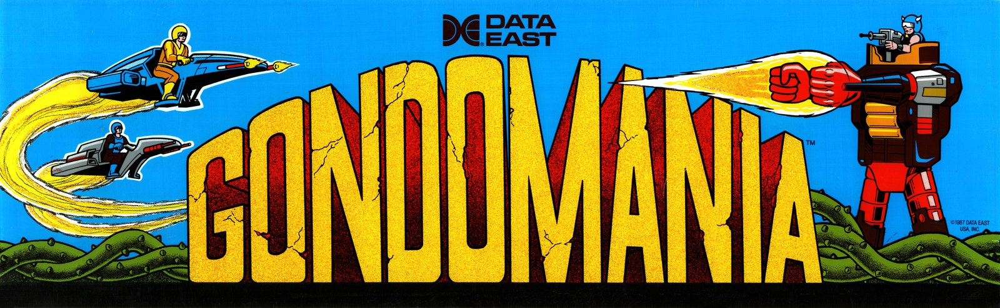
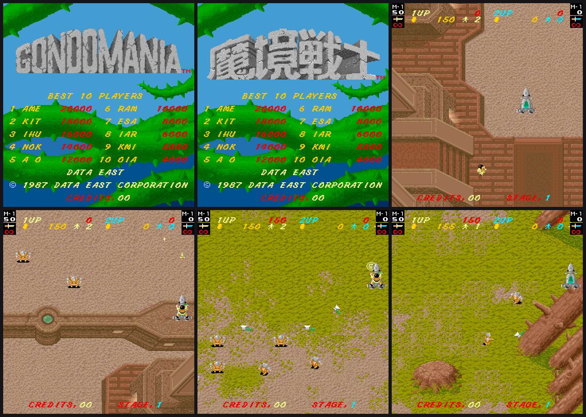
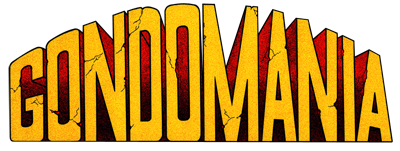
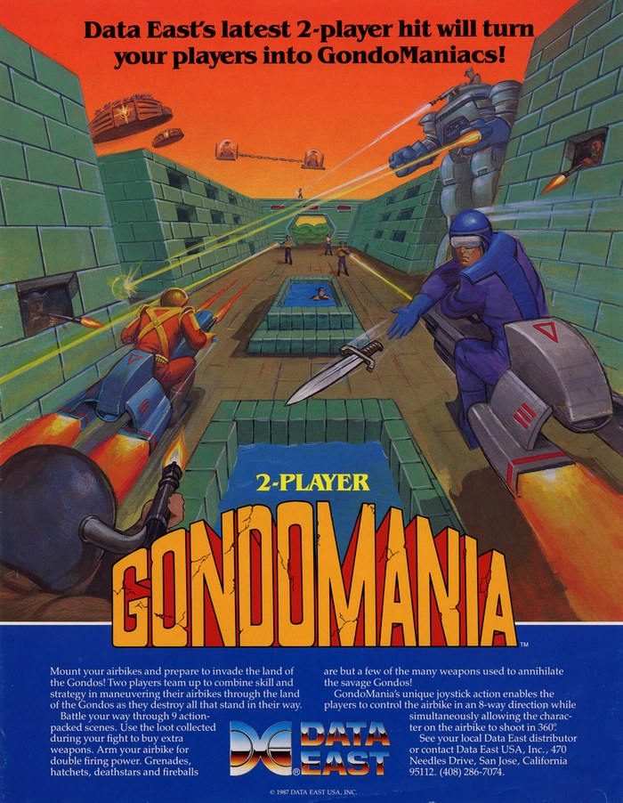
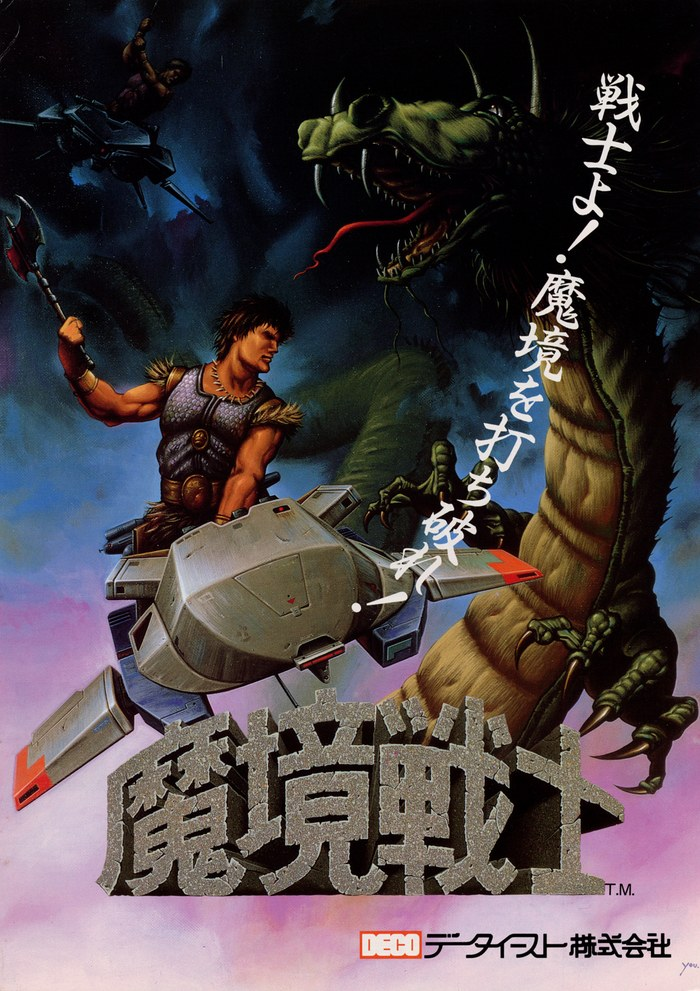
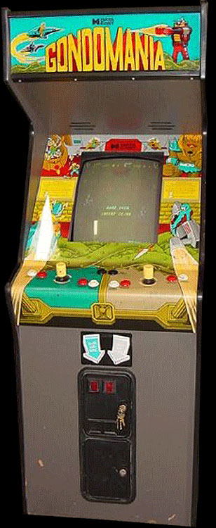
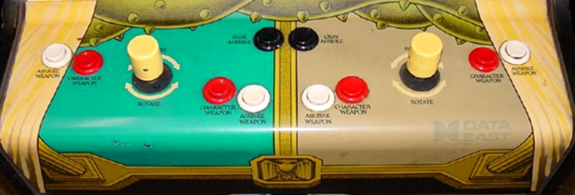
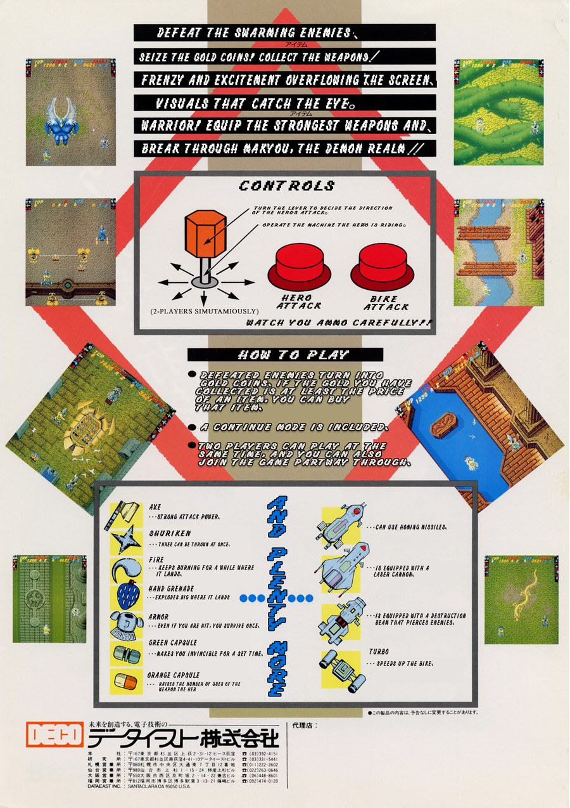
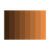
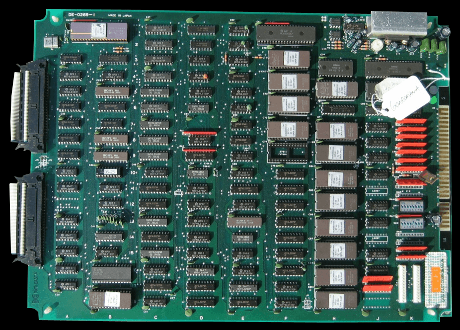

# Gondomania for MiSTer

Data East's 1987 arcade shooter **Gondomania** and its Japanese release **Makyou Senshi**, rebuilt from scratch for the MiSTer FPGA. Three versions in one core, scores that save, a sharp rotated picture on a CRT or HDMI, and separate volume controls for the music and the effects.

## At a glance

| &nbsp;&nbsp;&nbsp;&nbsp;&nbsp;&nbsp;&nbsp;&nbsp;&nbsp;&nbsp;&nbsp;&nbsp;&nbsp;&nbsp;&nbsp;&nbsp;&nbsp;&nbsp; | | |
|:-:|---|---|
|  | **Game** | A two player shooter: ride an air bike, fire straight ahead with one button and in any of twelve directions with the other, aimed with a rotary control |
|  | **Versions** | Gondomania (US), Gondomania (World) and Makyou Senshi (Japan), listed from the newest to the oldest. Picked in the OSD |
|  | **Players** | 1 or 2. Each pad has its own controls, mapped in MiSTer's Define joystick buttons |
|  | **High scores** | Load by themselves, save with one button, can be reset to the original table. Each version keeps its own |
|  | **Picture** | HDMI (rotated for a normal TV) and analog CRT (rotated, sized and smoothed from the OSD, or the raw sideways 15 kHz picture for a monitor on its side) |
|  | **Sound** | YM2203 effects and YM3526 music, with a volume for each, a master volume and a Treble option |

## The three versions

Gondomania was released in three versions, and the game was rebalanced as the releases went on. The Game Version option lists them from the newest to the oldest: **Gondomania (US)** is the final release and the most balanced version; **Gondomania (World)** came before it and is harder; **Makyou Senshi (Japan)** is the original release and the hardest of the three. The further back you go, the harder the game becomes. Each version has its own program, character, MCU and sound ROMs and its own high score table, so they play and score separately. (The OSD font has no kanji, so the Japanese title is written in letters there. The game itself shows 魔境戦士.)

## How to play

  

*The US flyer, the Japanese flyer and the upright cabinet. Gondomania, Makyou Senshi and the original artwork are Data East's.*

| &nbsp;&nbsp;&nbsp;&nbsp;&nbsp;&nbsp;&nbsp;&nbsp;&nbsp;&nbsp;&nbsp;&nbsp;&nbsp;&nbsp;&nbsp;&nbsp;&nbsp;&nbsp; | | |
|:-:|---|---|
|  | **Move** | An 8-way joystick moves your air bike. Player 1 rides the blue bike and player 2 the grey one |
|  | **Two weapons** | Hero Attack fires the character's weapon in the direction the rotary control points. Bike Attack fires the air bike's weapon straight ahead |
|  | **Turn** | The real cabinet has a 12 position rotary joystick. On a pad, Turn Left and Turn Right step it round, and keep stepping while held |
|  | **Coins and start** | Coin to add a credit, Start 1 or Start 2 to begin |
|  | **Gold and items** | Defeated enemies turn into gold coins. When the gold you have collected is at least the price of an item, you can buy that item |
|  | **Two players** | Two players can play at the same time, and a second player can join a game in progress. There is a continue mode |

*The back of the Japanese flyer (Makyou Senshi), translated into English by the author: the controls, how to play and the items. The original Japanese card is `docs/readme/art/flyer_jp_back.jpg`, and a plain text translation of both sides of the flyer is in `docs/readme/flyer_jp_back_translation.md`.*

## Controls

The controls and the items of the arcade game are explained on the translated flyer card above. On the MiSTer, the core uses the MiSTer controller mapping (Hero Attack, Bike Attack, Turn Left, Turn Right, Start, Coin). Map your pad in MiSTer's own **Define joystick buttons** (System menu, press Right on the main menu), then use the OSD button to leave the screen. A second pad of the same model shares that mapping and becomes player 2 when you press a button on it; a different model needs one pass of its own. There is no Service button: Service Mode is a switch in the OSD. Keyboard defaults:

| &nbsp;&nbsp;&nbsp;&nbsp;&nbsp;&nbsp;&nbsp;&nbsp;&nbsp;&nbsp;&nbsp;&nbsp;&nbsp;&nbsp;&nbsp;&nbsp;&nbsp;&nbsp; | | |
|:-:|---|---|
|  | **Coins and starts** | **5** and **6** coin 1 and 2, **1** and **2** start 1 and 2 |
|  | **Move** | The arrow keys |
|  | **Fire** | **Left Ctrl** is Hero Attack (the arm direction), **Left Alt** is Bike Attack (straight ahead) |
|  | **Turn the arm** | **Z** is Turn Left, **X** is Turn Right |

## The OSD at a glance

Open the OSD with the button on your controller or **F12** on a keyboard. The first choice of every option is the factory setting. The game reads its DIP switches when it starts. Changing Lives or Difficulty restarts the game for you; after changing any other DIP option (coinage, demo sounds, flip screen, continues) use Reset in the OSD. Every reset holds the whole core for at least 100 ms, like a power cycle.

| &nbsp;&nbsp;&nbsp;&nbsp;&nbsp;&nbsp;&nbsp;&nbsp;&nbsp;&nbsp;&nbsp;&nbsp;&nbsp;&nbsp;&nbsp;&nbsp;&nbsp;&nbsp; | | |
|:-:|---|---|
|  | **Game Version** | Gondomania (US), Gondomania (World) or Makyou Senshi (Japan). Restarts the game when you change it |
|  | **Video** | Separate options for HDMI and for the analog CRT output. The CRT options do nothing on HDMI and the other way round |
|  | **CRT Size** | 16 sizes, from 195x208 up to 217x232 and down to 105x112. CRT Smoothing keeps the scaled picture even; turn it Off for plain pixels |
|  | **VGA Scaler** | Off by default. When On, the analog port carries the HDMI picture instead of the raw 15 kHz raster, so a VGA or other 31 kHz monitor works |
|  | **Sound Settings** | Master, Music and Effects volume from Off up to 200 percent (100 percent is the default mix), and a Treble option |
|  | **DIP Switches** | Coinage for both players, lives (including Infinite), difficulty, continues, demo sounds, flip screen |

## Install

| &nbsp;&nbsp;&nbsp;&nbsp;&nbsp;&nbsp;&nbsp;&nbsp;&nbsp;&nbsp;&nbsp;&nbsp;&nbsp;&nbsp;&nbsp;&nbsp;&nbsp;&nbsp; | | |
|:-:|---|---|
|  | **You need** | The MiSTer **SDRAM module** and your own legally obtained ROM sets |
|  | **1. Core file** | Copy `Gondomania.rbf` to `/media/fat/_Arcade/cores/` |
|  | **2. MRA file** | Copy `Gondomania.mra` to `/media/fat/_Arcade/` |
|  | **3. ROM sets** | Put `gondo.zip`, `gondou.zip` and `makyosen.zip` from MAME in `/media/fat/games/mame/`. All three are needed, because the one MRA loads every version |
|  | **4. Play** | Start **Gondomania** from the Arcade menu |

No ROM data is included in this repository.

## High scores

| &nbsp;&nbsp;&nbsp;&nbsp;&nbsp;&nbsp;&nbsp;&nbsp;&nbsp;&nbsp;&nbsp;&nbsp;&nbsp;&nbsp;&nbsp;&nbsp;&nbsp;&nbsp; | | |
|:-:|---|---|
|  | **Restored for you** | Saved scores are put back a moment after the game starts, and again after an OSD **Reset** |
|  | **Save High Scores** | Writes the current top 10 of the running version to `/media/fat/config/nvram/Gondomania.nvm`. Nothing saves on its own, so you decide which scores are worth keeping |
|  | **Clear High Scores** | Asks "Are you sure you want to clear your hi scores? They will be lost forever." **Yes** puts the original top 10 back (and saves it). Either answer returns you to the main menu |
|  | **One table per version** | The US, World and Japan versions each have their own slot in the file, so scores never mix |

## Picture on HDMI and on a CRT

Gondomania is a vertical game: the arcade monitor stands on its side, so the raw video signal is sideways. This core can output that raw signal for a monitor on its side, or rotate the picture inside the core for a normally mounted CRT and for HDMI.

| &nbsp;&nbsp;&nbsp;&nbsp;&nbsp;&nbsp;&nbsp;&nbsp;&nbsp;&nbsp;&nbsp;&nbsp;&nbsp;&nbsp;&nbsp;&nbsp;&nbsp;&nbsp; | | HDMI | Analog CRT |
|:-:|---|---|---|
|  | **Orientation** | HDMI Orientation | CRT Orientation (Vertical raw, or Horizontal rotated) |
|  | **Flip** | Flip Monitor | CRT Flip |
|  | **Size and shape** | Aspect ratio | CRT Size and CRT Aspect (Square pixels or Arcade 3:4) |
|  | **Smoothing** | The MiSTer scaler | CRT Smoothing |
|  | **Position** | Not needed | CRT V Position and CRT H Position |

## The hardware

| Part | Original | In this core |
|---|---|---|
| Main CPU | Hitachi HD6309E (the 1987 manual lists a 6809E) | HD6309 core by Roger Taylor, based on Greg Miller's MC6809 core |
| Protection and I/O MCU | Intel 8751, 8 MHz | JT8751 by Jose Tejada around a translation of Oregano Systems' 8051 core |
| Sound CPU | Rockwell R65C02, 1.5 MHz | jt65c02 by Jose Tejada |
| FM sound | Yamaha YM2203 (OPN) with YM3014 DAC | jt03 by Jose Tejada (this game uses the FM voices for the effects) |
| OPL sound | Yamaha YM3526 | jtopl by Jose Tejada (this game uses it for the music) |
| Video | Custom ICs HMC-20, VSC-30, DRL-40, RM-C3 palette hybrids | Written for this core |
| Clocks | 12 MHz crystal (video), 8 MHz crystal (CPU board) | One 48 MHz clock with enables |
| Raster | 6 MHz pixel clock, 384 x 272 total, 256 x 240 visible, 57.44 Hz, vertical monitor | Same, rotated for display as chosen |

The program, character, MCU and sound ROMs of every version are kept in SDRAM and copied into the core's memory whenever the game starts or the version changes. The background tiles are shared by all versions, and each version has its own sprite ROM copy.

*The arcade board.*

## How it was made

This core is a clean-room reverse engineering of the game, not a copy of any other core. The hardware was worked out from MAME's driver source, the ROM code itself (read and traced, for example to find where each version keeps its high score table), the Data East service and technical support manuals and schematics, the datasheets of the standard chips, and tests against MAME and against video of a real board. The three Data East custom video chips, whose insides are not in the schematics, were rebuilt from how they behave on screen. meathax's released core was only looked at from the outside, as a reference for how the game should look and sound; none of its code was used.

## How it was checked

The video, the CPU and the MCU were compared with MAME frame by frame and instruction by instruction in simulation. The video matches MAME's screenshots exactly through the first 1,700 frames of the attract mode, and the sound level and balance were fitted to a MAME recording of real play. The overall game speed was measured against a capture of a real board and agrees to within one percent. The rotation hub is tested against an independent model, and the SDRAM paths are tested against a model of the real memory chip. The core runs on real hardware.

## Known limitations

* In simulation the core's attract demo matches MAME write for write for the first 1,740 frames (about 30 seconds). Then it makes one different random choice: the game reads its idle loop counter as a random number, and MAME and the core's CPU take an interrupt one cycle apart in a rare case. The difference only changes which way the demo goes, not how the game plays. Which of the two matches a real chip in that single cycle could only be settled on a real board.
* The exact positions of the sync pulses come from MAME's raster figures; the schematics keep them inside custom chips, so they were not measured on a real board.
* The rotary control and two player play need more testing on real hardware.

## Credits

| &nbsp;&nbsp;&nbsp;&nbsp;&nbsp;&nbsp;&nbsp;&nbsp;&nbsp;&nbsp;&nbsp;&nbsp;&nbsp;&nbsp;&nbsp;&nbsp;&nbsp;&nbsp; | | |
|:-:|---|---|
|  | **MeatHax** | Author of the DEC8 (DECO 8 bit) core for MiSTer, which brought Gondomania to the platform first. This core was written separately, from MAME and the original documents, and meathax's core served as a reference for how the game should look and sound. Thank you for the groundwork and for setting the bar |
|  | **Jose Tejada (jotego)** | The JTCORES chip cores used here: `jt65c02`, `jt03`, `jtopl`, `jt49` and the 8751 wrapper (GNU GPL v3). As their headers say, the sound cores build on information posted by **Nemesis** and on **Sauraen**'s OPN/OPN2 VHDL, which is based on die shots |
|  | **Oregano Systems, Roger Taylor and Greg Miller** | The original 8051 core, and the 6309 and 6809 cores |
|  | **Sorgelig and the MiSTer FPGA project** | The platform framework (`sys/`, `hps_io`, `arcade_video`) and the SDRAM controller this core's `sdram.sv` is built on |
|  | **The MAME project** | The driver source for the hardware and the reference used throughout |
|  | **Data East** | The original 1987 arcade game, and the operation and technical support manuals that document the hardware. All game assets and ROM content remain Data East's property. The flyer, marquee, cabinet, control panel and controls pictures are scans of the original arcade material |

This core was developed with substantial assistance from **Claude** (Anthropic's AI assistant) and Google's **Gemini**, on this and the earlier GX7 core family this work builds on. A full list of third-party components and their licenses is in `NOTICE.md`.

## License and authorship

Copyright (C) 2026 Eggsecutioner528. Licensed under the GNU General Public License, version 2 or (at your option) any later version; see `LICENSE`. Every original file carries a copyright header and a provenance mark. Anyone who copies or adapts this code must keep the notices, name the author and publish the complete source of the result under the same license.

## Building

Quartus Prime Lite 17.0, project `Gondomania.qpf`. The MRA is generated with `python tools/make_mra.py mra`.

<!-- Gondomania for MiSTer - Copyright (C) 2026 Eggsecutioner528  Licensed under the GNU General Public License, version 2 or (at your option) any later version (see LICENSE).  Any copy or derived work must keep this notice, name the author and be published with its complete source under the same license.  Provenance mark GDM-ee4605113c5e -->
